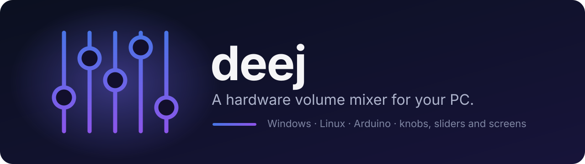
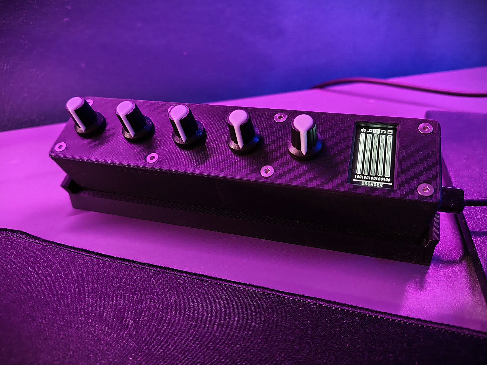
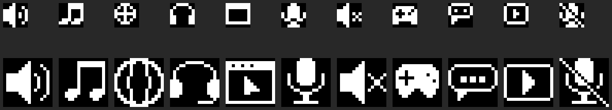

<p align="center">
  
</p>

<p align="center">
  <a href="https://github.com/Advve/deej/actions/workflows/build.yml"></a>
  <a href="https://github.com/Advve/deej/releases/latest"></a>
  <a href="LICENSE"></a>
  <br>
  
  
  
</p>

deej is an **open-source hardware volume mixer** for Windows and Linux PCs. Turn real knobs or sliders to **control the volume of individual apps** (your music player, the game you're playing, your voice chat) without leaving what you're doing.

It has two parts: a small desktop app written in Go, and an Arduino board with a few potentiometers that's cheap and simple to build.

> **This is a maintained fork of [omriharel/deej](https://github.com/omriharel/deej)**, created by [Omri Harel](https://github.com/omriharel). The original hasn't been updated since 2021 (last release v0.9.10, August 2020). This fork keeps it working with current hardware and drivers and adds support for boards with a screen. See [What's new in this fork](#whats-new-in-this-fork).


> _No 3D printer? [No problem](./assets/build-shoebox.jpg)._ deej works just as well built into cardboard, a shoebox or on a breadboard.

## Table of contents

- [What's new in this fork](#whats-new-in-this-fork)
- [Features](#features)
- [How it works](#how-it-works)
- [Configuration](#configuration)
- [Boards with a screen](#boards-with-a-screen)
- [Build your own](#build-your-own)
- [How to run](#how-to-run)
- [Building from source](#building-from-source)
- [Troubleshooting](#troubleshooting)
- [Credits](#credits)
- [Changelog](#changelog)
- [License](#license)

## What's new in this fork

- **Builds and runs on current Linux distributions.** The original's tray icon needed WebKit2GTK 4.0 and libappindicator3, which Ubuntu 24.04 and other current distributions no longer ship. This fork uses a tray library that talks to the desktop over D-Bus, so the Linux build is a single static binary that needs no extra packages.
- **Works with current CH340 drivers on Windows.** Many Arduino Nano clones use a CH340 USB chip. Since driver version 3.8 (2023), Windows returns empty reads from it, and the original deej connects but never reads a single slider value. This fork waits those out, so deej works on both old and new drivers.
- **Reconnects automatically.** Unplug the board, or let the PC sleep, and deej reconnects as soon as the board is back. It also waits for the board at startup instead of quitting. The original had to be restarted.
- **Support for boards with a screen.** deej now tells the board what each slider controls: a label, an icon, whether the current OS can drive it, and whether its app is running. It also sends a keepalive, so the board can tell when deej isn't running. See [Boards with a screen](#boards-with-a-screen).
- **[`deej-5-sliders-oled`](./arduino/deej-5-sliders-oled) firmware** for an Arduino Nano with 5 knobs and a 1.3" OLED, which shows all of that.
- **Two new optional config keys,** `slider_labels` and `slider_icons`, to choose what the screen shows.
- **Fewer session glitches.** Refreshing the list of audio sessions can no longer happen at the same moment a slider is using them.

Everything stays compatible:

- Existing `config.yaml` files work unchanged. The original deej ignores the new keys, so one file works with both.
- The [original firmware](./arduino/deej-5-sliders-vanilla/deej-5-sliders-vanilla.ino) works with this deej. It ignores what deej sends.
- The OLED firmware works with the original deej. It just shows the labels from its own `config.h`.

## Features

- Bind apps to sliders
  - Several apps on one slider (for example, all your games)
  - The master volume
  - Your microphone's input level
  - All apps that aren't bound to any other slider
  - The app in focus (Windows only)
  - "System sounds" (Windows only)
  - A specific audio device, by name (Windows only)
- Edit the config while deej is running: it reloads automatically
- Show labels, icons and app status on a board with a screen
- Reconnects by itself when the board is unplugged and plugged back in, or wakes up after sleep
- Runs from the system tray, uses around 10 MB of memory
- Notifications when something's wrong (board not found, broken config)

## How it works

### Hardware

- The sliders or knobs are wired to the analog pins of an Arduino Nano, Pro Micro or Uno, and powered from the board's 5V pin.
- The board connects to the PC over USB.


### Software

- The firmware on the board reads the sliders and keeps sending their values over USB serial, one line at a time: `512|1023|0|300|800`, each from 0 to 1023.
- The deej app runs in the background on the PC. It reads those lines and sets each app's volume according to `config.yaml`.
- With a screen, deej also sends a few short lines back to the board (see [Boards with a screen](#boards-with-a-screen)).

Two firmwares are included:

| Firmware | Hardware | What it does |
|---|---|---|
| [`deej-5-sliders-vanilla`](./arduino/deej-5-sliders-vanilla/deej-5-sliders-vanilla.ino) | Any board, 5 sliders on A0–A4 | Sends slider values. The original firmware, unchanged. |
| [`deej-5-sliders-oled`](./arduino/deej-5-sliders-oled) | Arduino Nano, 5 knobs, SH1106 or SSD1306 I2C OLED | Smoothed knob values, plus a screen with levels, labels and app status. |

## Configuration

deej reads `config.yaml` from the folder it runs in. Changes are picked up as soon as you save the file, with no restart needed.

```yaml
slider_mapping:
  0: master
  1: chrome.exe
  2: spotify.exe
  3:
    - pathofexile_x64.exe
    - rocketleague.exe
  4: discord.exe

# set this to true if you want the controls inverted (i.e. top is 0%, bottom is 100%)
invert_sliders: false

# settings for connecting to the arduino board
com_port: COM4
baud_rate: 9600

# adjust the amount of signal noise reduction depending on your hardware quality
# supported values are "low" (excellent hardware), "default" (regular hardware) or "high" (bad, noisy hardware)
noise_reduction: default
```

Slider numbers start at 0, whichever analog pins you use. What you can put in `slider_mapping`:

| Target | Controls |
|---|---|
| `chrome.exe`, `spotify`, … | That app (case doesn't matter; on Linux, use the name without `.exe`) |
| a list of apps | All of them, or whichever of them is running |
| `master` | The default playback device |
| `mic` | The default recording device's input level |
| `deej.unmapped` | Every app not bound to another slider |
| `deej.current` | The app in focus (Windows only) |
| `system` | "System sounds" in the Windows mixer (Windows only) |
| `Speakers (Realtek High Definition Audio)` | That device, by its full name as shown in the Windows volume menu. Works for inputs and outputs (Windows only) |

On Linux, `com_port` is usually `/dev/ttyUSB0` (CH340 boards) or `/dev/ttyACM0`.

### Screen labels and icons (optional)

For boards with a screen, deej works out a label and an icon for each slider from `slider_mapping`:

- `master` → MASTER, `mic` → MIC, `deej.current` → ACTIVE, `deej.unmapped` → OTHER
- `spotify.exe` → SPOTIFY. The `.exe` is dropped and the name is uppercased.
- A group of the same kind of app → BROWSER, MUSIC, VOICE, CHAT, VIDEO or GAMES. A mixed group → first app's name with a `+`.
- Known browsers, music players, voice and chat apps, video players and game launchers get a matching icon. Other apps get a window icon.

To pick your own, add either key and list only the sliders you want to change:

```yaml
slider_labels:
  3: GAMES
slider_icons:
  3: game
```

Labels are cut to 10 characters. Icons: `speaker`, `music`, `globe`, `headset`, `window`, `mic`, `muted`, `game`, `chat`, `video`, `micoff`.

## Boards with a screen

[](https://makerworld.com/en/models/3590850-deej-oled-volume-mixer-5-knob-arduino-nano-case)

> **Print this build:** the case, the 30° stand and ready-to-print profiles are on [MakerWorld](https://makerworld.com/en/models/3590850-deej-oled-volume-mixer-5-knob-arduino-nano-case), together with a parts list and an assembly guide PDF.



The [`deej-5-sliders-oled`](./arduino/deej-5-sliders-oled) firmware drives a 1.3" SH1106 (or 0.96" SSD1306) I2C OLED on an Arduino Nano, mounted portrait next to 5 knobs. It shows:

- **Overview:** one bar per knob with its icon and level.
  - A **dotted bar with `NA`**: this OS can't drive that slider, for example `deej.current` on Linux.
  - A **hatched bar**: the slider's app isn't running.
  - **`--`**: the slider isn't mapped.
- **Focus view:** the knob you're turning, shown big with its name and level.
- **"NO DEEJ"** and an X in the corner when deej isn't running.
- A dimmed, moving screensaver after 5 seconds, then the screen turns off.

What deej sent last is saved in the board's EEPROM, so labels are there even before deej starts. Only changed bytes are written, so the EEPROM won't wear out.

**Setup**

1. Install the **U8g2** library in the Arduino IDE (Tools → Manage Libraries).
2. Open [`config.h`](./arduino/deej-5-sliders-oled/config.h) and set your knob pins (`KNOB_PINS`, in slider order), screen type and rotation. The OLED uses A4 (SDA) and A5 (SCL).
3. Upload to the Nano.
   - Board: "Arduino Nano".
   - Processor: "ATmega328P", or "ATmega328P (Old Bootloader)" if the upload fails.
4. Set `com_port` in `config.yaml` and start deej.

With the original deej, set `SHOW_LINK_STATUS = false` in `config.h`. The original never sends the keepalive, so the screen would always say "NO DEEJ".

**Changing the icons:** they're drawn as text art in [`tools/gen_icons.go`](./arduino/deej-5-sliders-oled/tools/gen_icons.go). Edit the art and run `go run gen_icons.go` in that folder. It rewrites `icons.h` and the preview image. A new icon also needs its name in `ICON_NAMES` in the sketch and in `displayIcons` in [`pkg/deej/display.go`](./pkg/deej/display.go).

**Protocol:** the lines deej sends are documented at the top of [`pkg/deej/display.go`](./pkg/deej/display.go). Any firmware can read them, and they never look like slider values.

## Build your own

### Parts

- An Arduino Nano, Pro Micro or Uno (or any board with USB serial). The Nano and Pro Micro are smaller and cheaper.
- Slider or rotary potentiometers, as many as you have free analog pins. Cheap 10K ones work fine. Make sure they're **linear**, not logarithmic.
- Wires.
- Optional: a 1.3" SH1106 or 0.96" SSD1306 I2C OLED, for the [screen firmware](#boards-with-a-screen).
- A box: 3D-printed, cardboard, anything.

The case in the photo above, with its stand and print profiles, is on [MakerWorld](https://makerworld.com/en/models/3590850-deej-oled-volume-mixer-5-knob-arduino-nano-case). Looking for other ideas? See builds by the original deej community in the [community showcase](./community.md), many with enclosure designs. Tech Always also made a [build video](https://youtu.be/x2yXbFiiAeI) covering parts, assembly and software.

### Assembly

1. Wire everything according to the [schematic](#hardware). Check your pots with a multimeter.
2. Flash one of the [firmwares](#software). With the vanilla one, edit the sketch if you don't have exactly 5 sliders.
3. Open the Arduino serial monitor at 9600 baud. You should see lines like `0|240|1023|0|483`, and each number should go from 0 to 1023 as you move its slider.
4. Close the serial monitor, since only one program can use the port, and run deej.

The [FAQ](./docs/faq/faq.md) covers wiring, uploading, finding your COM port and editing the config in more detail.

## How to run

Download deej from the [latest release](https://github.com/Advve/deej/releases/latest): `deej.exe` for Windows, `deej-linux-amd64` or `deej-linux-arm64` for Linux, and `config.yaml`. Each is a single file with nothing to install. You can also [build it yourself](#building-from-source).

### Windows

1. Put `deej.exe` and `config.yaml` in the same folder. deej isn't code-signed, so SmartScreen may warn the first time: **More info → Run anyway**.
2. Set `com_port` to your board's port. Device Manager → Ports (COM & LPT) shows it.
3. Run `deej.exe`. It appears in the system tray.
4. Optional: to start deej with Windows, tick **Start with Windows** in the tray menu. It adds deej to your startup apps (Task Manager → Startup apps lists it), with no shortcuts to copy. If you move the folder later, run deej once from the new place and it updates the entry.

### Linux

1. Install the program and the config in the standard places:
   ```bash
   install -Dm755 deej-linux-amd64 ~/.local/bin/deej    # or deej-linux-arm64
   install -Dm644 config.yaml ~/.config/deej/config.yaml
   ```
   The log goes to `~/.local/state/deej/` (`$XDG_CONFIG_HOME` and `$XDG_STATE_HOME` are respected). Keeping `config.yaml` in the same folder as the program, like on Windows, works too.
2. Set `com_port` in `~/.config/deej/config.yaml`, usually `/dev/ttyUSB0`.
3. Make sure your user can open serial ports: `sudo usermod -aG dialout $USER`, then log out and back in.
4. Use Linux app names in `slider_mapping` (`spotify`, not `spotify.exe`).

The tray icon uses the StatusNotifierItem (AppIndicator) standard. KDE Plasma, Xfce, Cinnamon, MATE, Budgie and most other desktops show it. GNOME needs the "AppIndicator and KStatusNotifierItem Support" extension, which Ubuntu enables by default. Without a tray, deej still works but has no icon. Stop it with `pkill deej` (or whatever you named the file). "Edit configuration" in the tray menu opens `config.yaml` in your default text editor, and **Start at login** adds deej to your desktop's autostart (`~/.config/autostart/deej.desktop`).

### Updates

A couple of minutes after it starts, and then once a day, deej asks GitHub for the latest release. That request is all it sends. When a newer version is out, an **Update available** item appears at the top of the tray menu and you get one notification for it:

- **Install and restart** downloads the new program, checks it against the release's signed `SHA256SUMS.txt`, swaps it in place of the old one and restarts deej. `config.yaml`, the log and *Start with Windows* stay as they were.
- **What's new** opens the release page. **Skip this version** hides it until a newer one comes out.

If deej can't replace its own file (for example, it's in a folder you can't write to), the item says **Download…** and opens the release page instead. Untick **Updates → Check automatically** in the tray menu to stop the daily check; **Updates → Check now** checks right away. The setting is kept in `preferences.yaml` next to the log, not in `config.yaml`.

## Building from source

You need Go 1.22 or newer. deej is pure Go: no C compiler or system libraries, and any OS can build for the others.

- **Windows:** run `pkg\deej\scripts\windows\build-release.bat`. It writes `deej-release.exe` in the repository root.
- **Linux:** run `pkg/deej/scripts/linux/build-release.sh` from the repository root. It writes `deej-release`, a static binary that runs on any distribution.
- **Anything else:** `GOOS=linux GOARCH=arm64 CGO_ENABLED=0 go build -ldflags "-X main.buildType=release" ./pkg/deej/cmd`. This is the same command the CI uses. Set `GOOS`/`GOARCH` for the target and add `-H=windowsgui` to the flags for Windows.

`build-dev.bat` / `build-dev.sh` build a console version that shows logs. `deej -v` turns on verbose logging, which shows every line read from the board, and `deej -version` prints the version.

Releases are built by GitHub Actions; see [Releasing](./docs/CONTRIBUTING.md#releasing).

## Troubleshooting

- **"Waiting for COMx"**: the board isn't plugged in, or the port in `config.yaml` is wrong. deej keeps waiting and connects as soon as the port appears. The port can change when you use a different USB socket; Device Manager shows the current one.
- **Flashing the board while deej runs**: deej retries the port every 2 seconds and lets go of a busy one, but the upload can occasionally lose the race for the port. If it does, upload again, or quit deej while flashing.
- **deej connects but nothing happens when you move a slider**: check the board in the Arduino serial monitor first. With the original deej and a CH340 board, it can also be the driver problem this fork fixes.
- **"This serial port is busy"**: close the Arduino serial monitor, or any other program using the port.
- deej writes a log to `logs/deej-latest-run.log` next to the executable, or on Linux with the config in `~/.config/deej`, to `~/.local/state/deej/deej-latest-run.log`. The first lines say which config file and log folder it uses.

## Credits

- deej was created by **[Omri Harel](https://github.com/omriharel)**: the original [omriharel/deej](https://github.com/omriharel/deej). If you'd like to thank him, he has a [Ko-fi page](https://ko-fi.com/omriharel).
- The original deej community is still on [Discord](https://discord.gg/nf88NJu). It's about the original deej, not this fork, so report this fork's problems here on GitHub.
- The community builds in [community.md](./community.md) are by their respective makers.

## Changelog

- **0.4.0**, update check and one-click install
  - New: update check and one-click install from the tray. When a new version is out, an *Update
    available* item appears in the menu with one notification; *Install and restart* downloads it,
    verifies its signature and restarts deej. Turn off the daily check under *Updates → Check
    automatically*.
  - **Install this version by hand one last time.** Older versions have no updater, so they won't
    announce it; from this version on, later releases install from the tray.
- **0.3.0**, tray theme and autostart
  - The tray menu follows the Windows dark/light theme, and switches when you change it
  - "Start with Windows" (Linux: "Start at login") in the tray menu, instead of copying a shortcut
    to the Startup folder
  - deej finds `config.yaml` next to the program even when started from another folder
  - Linux: the program can go in `~/.local/bin` with the config in `~/.config/deej/config.yaml`
    and the log in `~/.local/state/deej/`; a `config.yaml` next to the program still works

- **0.2.0**, automatic reconnecting
  - Reconnects automatically when the board is unplugged and plugged back in, or after the PC
    wakes from sleep; no more restarting deej
  - Waits for the board at startup ("Waiting for COMx") instead of quitting when it isn't plugged in
  - Lets go of a busy port and retries every 2 seconds, so flashing the board while deej runs works
  - Every slider's volume and the screen labels are sent again after reconnecting

- **0.1.0** (first release of this fork), based on deej 0.9.10 by Omri Harel
  - Works with CH340 USB drivers 3.8 and newer on Windows, which the original reads nothing from
  - Builds and runs on current Linux distributions: pure Go, no GTK, WebKit or AppIndicator
    libraries needed, and Linux ARM64 builds
  - Sends each slider's label, icon, OS support and running app, plus a keepalive, to boards with
    a screen; new optional `slider_labels` and `slider_icons` config keys
  - New `deej-5-sliders-oled` firmware for an Arduino Nano with a 1.3" or 0.96" OLED
  - Session refreshes no longer collide with slider moves; Ctrl+C and SIGTERM are always caught;
    "Edit configuration" opens the desktop's default editor on Linux
  - `-version` flag, version information in the .exe, and third-party license notices with every release
  - Needs Go 1.22 to build

## License

MIT, like the original. See [LICENSE](./LICENSE). [`THIRD-PARTY-NOTICES.txt`](./THIRD-PARTY-NOTICES.txt) lists the licenses of the libraries deej is built with.
